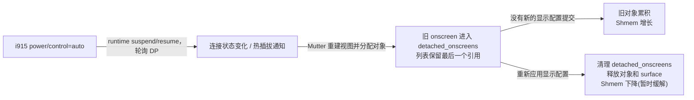

---
date:
  created: 2026-10-04T23:10:00.000Z
  updated: 2026-10-04T23:10:00.000Z
title: Ubuntu 24 内存异常排查：定位到 GDM 图形会话
createTime: 2026/10/04 23:10:00
permalink: /blog/shmem-diag/
categories:
  - 踩坑记录
comments: true
---

之前，201server 的内存膨胀到整台机器完全卡死，只能物理重启。随后将内存从 16G 升级到了 32G(~~成本颇高~~)，也为可能的高负载容器加上了资源限制和监控。

但大约半个月之后，宿主机的 Shmem 又涨到了约 18.6GiB，16GiB swap 几乎用满。

这次沿着历史采样数据重新排查，主要占用最终定位到 GDM 的登录界面会话。进一步验证发现，核显运行时自动省电触发了反复的连接检测和显示视图重建，而 Mutter 的 `detached_onscreens` 列表保留了旧图形对象的最后一个引用，导致内存不断积累。下面记录这次排查的过程。

<!-- more -->

## 1. 机器卡死，重启大法+监控服务

201server 是放在实验室的一台个人 Ubuntu 机器，平时跑sub2api, 内网穿透, Hermes, m7a等服务。

9 月 15 日, 机器内存占用膨胀到 16G，swap 几乎用满，导致整台机器卡死。物理重启和内存扩容(16G -> 32G)后暂时恢复了运行。

平时的高负载应用是 m7a（March7th Assistant）的容器定时任务，排查自然先从它开始。

- 在GPT 5.6 的分析中, 仅定位到Shmem异常, 但缺少进一步的监控数据
- 初步怀疑 m7a 的内存泄露或者启动配置异常, 导致启动了GUI, 进而占用大量内存

所以为 m7a 加上资源限制，并部署了常驻监控。监控同时记录容器与宿主机的内存变化，异常时保存快照，便于后续对照。

::: note 机器具体配置如下：

| 项目 | 规格 |
| --- | --- |
| 内存 | 扩容后 32G，系统可见 31.09GiB RAM；另有 16GiB swap（`/swap.img`） |
| CPU | 12 逻辑核 |
| 系统 | Ubuntu 24.04，内核 7.0.0-31-generic |
| 图形栈 | libmutter-14-0 46.2-1ubuntu0.24.04.14、<br>gnome-shell 46.0-0ubuntu6~24.04.13、<br>Mesa 25.2.8-0ubuntu0.24.04.2 |

:::

## 2. 扩容后，内存仍在持续增长

> **扩容之后，机器仍然出现了内存不足的问题。忍不了了, 严查!**

监控留下的快照显示，GDM 会话的内存和 swap 总量仍在增长。

| 时间 | GDM 内存（GiB） | GDM swap（GiB） | 合计（GiB） |
| --- | ---: | ---: | ---: |
| 10-03 19:07 | 16.50 | 0.00 | 16.50 |
| 10-04 03:07 | 24.25 | 0.15 | 24.40 |
| 10-04 15:07 | 26.86 | 7.95 | 34.81 |
| 10-04 22:11 | 18.70 | 15.62 | 34.32 |

> `cgroup`（control group）是 Linux 用来归组和限制进程资源的机制。这里用它统计 GDM 会话和 m7a 容器各自的内存、swap 及限制；父子 cgroup 的统计可能重叠，不能直接相加。

- 前几个时间段的总量接近线性增长，部分窗口接近 1GiB/小时。

翻看日志还发现，此前已经发生过一次 OOM，hermes 通知服务被内核杀掉。

### 2.1 解除对 m7a 的怀疑

先回到最初怀疑的 m7a 服务：

- 已有历史采样里，它的 cgroup shmem 一直为零；容器也没有设备映射，没有开启 privileged。
宿主机几十 GiB 的 Shmem 并没有体现在它的 cgroup 里。
- m7a 因反复重启被监控自动隔离，但停止后宿主机异常内存并没有大幅释放。
- 检查图形服务的启动记录后，也没有发现 m7a 参与：GDM 由 systemd 随系统启动，异常会话属于宿主机的登录界面。

### 2.2 从 Shmem 查到 GDM 的图形对象

1. 沿宿主机 cgroup 逐层排查后，发现异常占用主要集中在 GDM 的 Wayland 登录界面会话。该会话的 shmem 约为 18.5 GiB，swap 约为 15.6 GiB，与整机的异常内存占用基本吻合。
2. 进一步检查该会话中的 gnome-shell，其 DRM fdinfo 显示进程持有约 36 GiB 图形对象，其中约 13.8 GiB 驻留在内存中。驱动侧的 GEM 对象统计也与该会话的 unevictable 内存规模接近，多项证据均指向 GDM 会话持有的大量图形对象。
3. 帧缓冲和导出的 dma-buf 占用都很小，无法解释这几十 GiB 的内存占用。

> `GDM`（GNOME Display Manager）是 GNOME 的登录管理器，负责启动登录界面及其图形会话。
>
> `gnome-shell`: GNOME 的桌面 shell 和合成器，负责绘制面板、窗口和登录界面；Wayland 会话中的图形对象主要由它与 Mutter 管理。
>
> `Wayland`: Linux 图形会话使用的显示协议。
>
> `DRM`: Linux 内核的图形设备接口，`fdinfo` 可以提供进程关联的 GPU 对象统计。
>
> `dma-buf`: 内核共享图形缓冲区。
>
> `i915` 是 Intel GPU 使用的 Linux 内核驱动。后文通过它的 DRM 客户端统计，将 gnome-shell 持有的图形对象与对应会话关联起来。

### 2.3 查阅 Mutter 的上游相关修复

> Mutter 是 GNOME 桌面环境里的窗口管理器和合成器，负责管理窗口、合成画面并驱动显示输出，GNOME Shell 底层大量依赖它。

顺着旧图形对象的回收逻辑，查到了对应的上游修复：
[GNOME/mutter MR !5285](https://gitlab.gnome.org/GNOME/mutter/-/merge_requests/5285)

- 旧实现只在提交新的显示配置和退出时清理 `detached_onscreens`。
- 如果显示视图不断重建，却没有新的显示配置提交，旧 onscreen 对象及其图形内存就可能持续累积。
- 上游补丁调整了旧对象的引用与清理时机，避免它们在这条路径中不断积累；该修复已列入 Mutter 50.5 的 NEWS。

比对源码和 Ubuntu 发行版补丁后，本机的 Mutter 46.2 仍保留旧逻辑，没有包含这项修复。后续取证进一步确认了这段回收逻辑与本机对象累积现象的对应关系。

## 3. 进一步分析：Mutter旧对象的回收路径

### 3.1 验证归属与核显电源策略

短暂停止 GDM 后，会话持有的异常占用随之释放，全机 Shmem 从约 15.37GiB 降到 0.12GiB，swap 降至约 0.21GiB。重启 GDM 后，新的会话又出现了图形对象增长。

随后在同一个 gnome-shell 进程中，仅改变核显的运行时电源策略进行对照。将 `power/control` 改为 `on` 后，连接轮询、热插拔通知、GEM 大对象分配和 Shmem 增长都停止；恢复为 `auto` 后，这些现象重新出现。

> 核显的运行时电源策略由设备的 `power/control` 控制：`auto` 允许空闲时运行时挂起（runtime suspend），需要使用时再恢复（runtime resume）；`on` 禁止运行时挂起，但不代表核显一直满载。

每段观察三分钟，结果如下：

| 核显 `power/control` | GDM Shmem 净变化（MiB） | DRM 对象总量净变化（MiB） | 轮询、热插拔通知和大对象分配 |
| --- | ---: | ---: | --- |
| `auto`（基线） | +79.95 | +80.06 | 持续出现 |
| `on` | 0.00 | 0.00 | 停止 |
| 恢复 `auto` | +70.01 | +70.11 | 再次出现 |

进一步的调用栈跟踪确认，i915 的运行时挂起和恢复伴随着 DP 连接轮询；检测到连接状态变化后，驱动发出热插拔通知，Mutter 重建显示视图并分配新的图形对象。这说明核显运行时自动省电是本次增长的已验证触发条件。

> `DP`（DisplayPort）是一种显示接口。这里的“热插拔通知”是驱动报告的连接状态变化，不代表有人实际插拔了线缆。

### 3.2 `detached_onscreens` 保留最后一个引用

进一步分析在重启后的 GDM 会话中进行，跟踪同一个 gnome-shell 进程，并通过 i915 的 DRM 客户端统计关联其图形对象。

内存堆积和释放的过程可以概括为：



在核显运行时电源策略为 `auto` 时，捕捉到旧 onscreen 对象退役的完整引用链：

> `onscreen` 是 Mutter 内部表示一块显示渲染目标的对象，关联视图和图形缓冲区。对象进入 `detached_onscreens` 后，已经不再是当前显示视图，但仍等待安全释放。

```text
旧 onscreen：引用计数 2
  → 加入 detached_onscreens，g_object_ref：2 → 3
  → renderer 重建旧视图，unref：3 → 2
  → stage 释放旧视图，unref：2 → 1
  → detached_onscreens 继续持有 1；没有 dispose
```

清理前的样本中，列表有 55 项，全部 `refs=1`、`view=NULL`，但 GBM surface 仍存在；`pending_mode_set=1`，`lingering_onscreens` 为空。也就是说，这些对象已经不再是正在显示的视图，列表却仍然持有它们的最后一个引用。

> `GBM surface`（Generic Buffer Management surface）是 Mesa/Mutter 用来管理显示缓冲区的一组图形对象，供渲染和提交使用。销毁它也不代表所有底层 GPU 内存已经同步释放。

#### 3.2.1 重新应用显示配置时触发清理

进一步跟踪捕捉到 Mutter 重新应用显示配置，把连接状态、分辨率和刷新率等设置提交给底层 DRM/KMS；这一步触发了旧对象的清理：

> `DRM/KMS` 是 Linux 图形栈的两层接口：DRM 管理 GPU 设备和缓冲区，KMS 把连接状态、分辨率和刷新率等配置应用到显示输出。

1. 进入 `meta_renderer_native_post_mode_set_updates` 时，`pending=1`；随后 `pending` 变为 0，调用 `clear_detached_onscreens`。
2. 清空 detached 列表，并执行 `g_list_free_full(..., g_object_unref)`，释放列表持有的引用。
3. 清理前的 55 个对象全部 dispose、weak-free，55 个 GBM surface 全部 destroy；最终 `detached=0`、`lingering=0`、`pending=0`。

清理前后逐一比对对象指针和 surface 指针，结果均为 55/55；两个新退役对象还捕捉到了引用计数从 1 降到 0 的最后一次 `unref`。因此这次可以确认：Mutter 的 `detached_onscreens` 列表就是这些旧对象的最后持有者，重新应用显示配置是释放条件。

#### 3.2.2 释放对象与释放内存是两个阶段

进一步分析中的 cgroup swap 一直为 0，按对象清理的不同阶段统计，Shmem 变化如下：

| 观测阶段 | Shmem 初值 → 末值（MiB） | 旧对象列表 |
| --- | ---: | --- |
| 清理前 | 1401.828 → 1437.836 | 54 → 55，持续 `pending=1` |
| 提交显示配置并清理 | 1437.836 → 1169.844 | 55 → 0 |
| 后续释放与新分配 | 1169.844 → 737.422 | 再次开始累积，结束 2 项 |

旧 onscreen 和 GBM surface 销毁后，DRM 对象总量没有立即归零，而是继续下降。后续跟踪还捕捉到 Mesa 关闭 GEM handle 和内核销毁 GEM 对象的不同阶段，因此不能把“onscreen 已销毁”直接写成“所有相关图形内存同步释放”。GDM Shmem 随后降到约 165.44 MiB，又回升到 221.453 MiB；后续仍有新分配，列表也重新增长，所以阶段内的净下降不代表问题已经解决。

> `GEM`（Graphics Execution Manager）对象是内核表示 GPU 缓冲区的对象。关闭一个 GEM handle 只代表某个用户态引用结束，内核对象可能还会因缓存或其他引用延后销毁，所以两类事件不一定同时发生。

## 4. 解决方案

已确认内存持续增长原因：

- 核显的 `power/control=auto` 允许运行时挂起和恢复，i915 的连接轮询反复检测到状态变化，触发 Mutter 重建显示视图。
- Mutter 把旧 onscreen 放进 `detached_onscreens`，保留它的最后一个引用。没有新的显示配置提交时，这些对象无法释放；反复重建又继续增加旧对象，最终造成内存积累。

解决方案-关闭核显省电模式:

1. 将核显 `power/control` 改为 `on`, 避免该bug导致的内存增长；

    - 5min实测下, 并没有明显的功耗提升

2. 重新应用显示配置或结束 GDM，释放已经保留的对象。

为什么不考虑修复bug:

1. Ubuntu 24 的 Mutter 46.2 没有包含上游修复，升级到 Mutter 50 系列需要升级 GNOME Shell 和相关依赖，可能会引入其他不兼容问题；
2. 自行编译或回补补丁会增加维护负担

## 5. 总结

1. 排查过程中, codex被m7a误导, 进行了过分的排查和监控, 还影响了m7a服务的文档, 配置和约束, 导致后续在m7a的其他代码开发任务中会读到这些监控和约束的影响, 需要在后续的开发中注意
2. 不管是opus5.5还是sol6.1的写作能力都不太行, 需要大量的人工修改
    - 总结了写作风格skill, 希望后续有效

## 参考

- GNOME 上游补丁：<https://github.com/GNOME/mutter/commit/af0c9808.patch>
- Mutter 46 系列源码（`meta-renderer-native.c`）：<https://raw.githubusercontent.com/GNOME/mutter/46.2/src/backends/native/meta-renderer-native.c>
- Mutter 50 系列 NEWS（含该修复）：<https://raw.githubusercontent.com/GNOME/mutter/gnome-50/NEWS>
- 内核 DRM usage-stats 文档（fdinfo 字段口径）：<https://docs.kernel.org/gpu/drm-usage-stats.html>
- 内核运行时电源管理文档（`power/control`）：<https://docs.kernel.org/power/runtime_pm.html>
